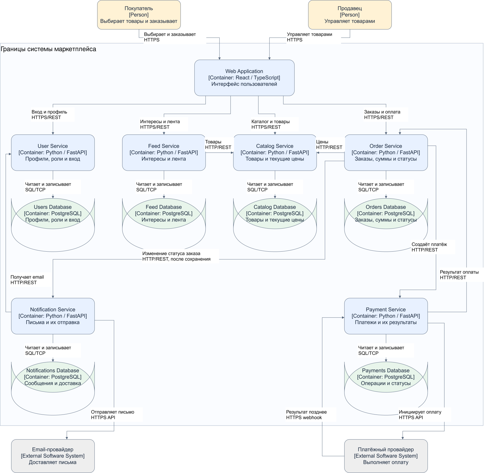

# Архитектура маркетплейса

Система разделена на шесть сервисов: пользователи, каталог, лента, заказы, платежи и уведомления. У каждого сервиса своя ответственность и собственная база данных.

## Требования и допущения

Маркетплейс должен поддерживать управление пользователями и товарами, персонализированную ленту, оформление заказов, расчёт и учёт платежей, уведомления о статусах заказов.

Для проектирования я приняла несколько допущений:

- Покупатели и продавцы используют одно веб-приложение. Доступные действия зависят от роли пользователя. Один пользователь может быть и покупателем, и продавцом.

- Персонализация работает по выбранным категориям интересов. Сначала показываются товары из этих категорий, внутри групп — более новые товары. Если интересы не указаны, пользователь видит общую ленту новых товаров.

- Оплата проходит через внешнего платёжного провайдера.

- Скидки, комиссии, налоги и доставка пока не рассматриваются. Поэтому сумма платежа равна сумме заказа (это, конечно, очень упрощенный подход, но при желании можно потом будет докрутить...).

- Уведомления отправляются по электронной почте.

- Складские остатки не входят в текущую модель.

### Развитие персонализации с использованием ML

В начальном варианте Feed Service формирует ленту по выбранным категориям интересов и дате публикации товаров. Такой подход работает без накопленной истории поведения и не требует обучения модели.

При появлении достаточного количества данных персонализацию можно расширить: учитывать просмотры, добавления в избранное и покупки, а затем использовать ML-модель для ранжирования товаров.

Для этого Feed Service потребуется хранить историю взаимодействий. События просмотров и избранного будут поступать от веб-приложения через API, сведения о покупках — от Order Service через HTTP API. Модель будет обучаться периодически, отдельно от обработки запросов на получение ленты.

Для новых пользователей и при недоступности модели сохранится базовая выдача по интересам и новизне товаров.

Выделять рекомендации в дополнительный сервис пока не планируется. Отдельный Feed Service уже позволяет развивать персонализацию независимо от управления каталогом. Сбор истории и ML-модель относятся к возможному развитию системы и не входят в текущий вариант реализации.

## Домены и распределение по сервисам

Домен — это область бизнес-задач со своими данными и правилами. В этой архитектуре я выделила шесть доменов и для каждого предусмотрела отдельный сервис.

**Пользователи — User Service.** Отвечает за регистрацию, вход, профили, роли покупателей и продавцов, контактные данные.

**Каталог — Catalog Service.** Отвечает за создание и изменение товаров продавцами. Хранит категории, описания, актуальные цены и статусы публикации товаров.

**Персонализированная лента — Feed Service.** Хранит категории интересов пользователя и формирует порядок товаров в ленте. Сведения о самих товарах получает из Catalog Service.

**Заказы — Order Service.** Отвечает за оформление заказов, их состав, итоговую стоимость и статусы.

**Платежи — Payment Service.** Получает подтверждённую стоимость заказа, определяет сумму платёжной операции, обращается к платёжному провайдеру и учитывает результат оплаты. При выбранных допущениях сумма операции равна стоимости заказа.

**Уведомления — Notification Service.** Получает HTTP-запросы с изменениями статусов заказов, подготавливает письма и учитывает попытки отправки.

Такое разделение позволяет менять персонализацию независимо от каталога, а платёжную интеграцию — независимо от работы с заказами. Уведомления вынесены отдельно. Order Service сначала сохраняет новый статус заказа, затем отправляет запрос в Notification Service. Ошибка отправки письма не отменяет изменение статуса, но требует повторной попытки.

## Основные элементы системы

Для пользовательского интерфейса предусмотрено веб-приложение на React и TypeScript. Backend-сервисы используют Python и FastAPI, базы данных — PostgreSQL.

Для взаимодействия между сервисами используются HTTP/REST-запросы. Также система взаимодействует с двумя внешними системами: платёжным провайдером и провайдером электронной почты.

## Владение данными

Каждый сервис работает только со своей базой. Общей базы между сервисами нет. Если нужны данные другого сервиса, они передаются через HTTP API.

| Сервис | База данных | Основные данные |
|---|---|---|
| User Service | Users Database | Профили, роли, данные аутентификации, email |
| Catalog Service | Catalog Database | Товары, категории, текущие цены, продавцы и статусы публикации |
| Feed Service | Feed Database | Категории интересов пользователей |
| Order Service | Orders Database | Заказы, позиции, зафиксированные цены, суммы и статусы |
| Payment Service | Payments Database | Платёжные операции, суммы, валюты, статусы и идентификаторы провайдера |
| Notification Service | Notifications Database | Сообщения, получатели, статусы и попытки отправки |

При оформлении заказа Order Service сохраняет название и цену товара на этот момент. Если продавец позже изменит цену в каталоге, стоимость уже созданного заказа не изменится.

Order Service владеет составом и стоимостью заказа, а Payment Service — платёжной операцией и её результатом. После оплаты Payment Service сообщает результат, и Order Service сам обновляет статус заказа.

## Взаимодействия сервисов

Сервисы взаимодействуют через синхронные HTTP-запросы. Результат оплаты поступает позднее через webhook платёжного провайдера.

### Синхронные запросы

При синхронном взаимодействии сервис отправляет запрос и ждёт ответ.

Веб-приложение обращается к сервисам по HTTPS/REST:

- к User Service — для входа и работы с профилем;

- к Catalog Service — для просмотра каталога и изменения товаров;

- к Feed Service — для настройки интересов и получения ленты;

- к Order Service — для создания и просмотра заказов, начала оплаты.

Между сервисами используются HTTP/REST-запросы:

- Feed Service получает опубликованные товары из Catalog Service;

- Order Service получает актуальные сведения и цены из Catalog Service;

- Order Service передаёт запрос на создание платежа в Payment Service;

- Notification Service получает email пользователя из User Service.

Payment Service инициирует оплату через HTTPS API платёжного провайдера. Notification Service отправляет письма через HTTPS API email-провайдера.

Платёжный провайдер позднее сообщает результат оплаты через webhook — HTTP-запрос к Payment Service.

### Передача результатов оплаты и статусов заказов

Payment Service сохраняет результат оплаты, затем отправляет HTTP/REST-запрос в Order Service. В запросе передаются идентификатор платежа, идентификатор заказа и результат: `PaymentSucceeded` или `PaymentFailed`.

Order Service сохраняет новый статус заказа, затем отправляет HTTP/REST-запрос в Notification Service с данными об изменении статуса (`OrderStatusChanged`). Notification Service подготавливает и отправляет уведомление.

Отправитель ждёт ответа на каждый HTTP-запрос. Ошибка отправки уведомления не отменяет уже сохранённый статус заказа. При недоступности получателя запрос нужно повторить; данные для повторной попытки должны сохраняться в базе сервиса-отправителя. Повторный запрос не должен повторно применять уже обработанное изменение или создавать второе уведомление.

Между получением результата оплаты и обновлением заказа возможна задержка, особенно если запрос приходится повторять. Таймаут платёжного провайдера сам по себе не означает отказ: результат оплаты может оставаться неизвестным до подтверждения.

### Пример оформления и оплаты заказа

1. Покупатель оформляет заказ через веб-приложение.

2. Order Service запрашивает товары и цены у Catalog Service, затем сохраняет состав и сумму заказа.

3. При начале оплаты Order Service обращается к Payment Service.

4. Payment Service создаёт платёжную операцию и отправляет запрос провайдеру.

5. Провайдер сообщает результат через webhook.

6. Payment Service сохраняет результат и отправляет его в Order Service через HTTP API.

7. Order Service сохраняет новый статус заказа и отправляет HTTP-запрос в Notification Service.

8. Notification Service получает запрос и отправляет покупателю письмо.

Обработка повторных запросов, повторная передача результатов оплаты и запросов на уведомление, а также восстановление после сбоев понадобятся при дальнейшей реализации. В текущем задании эти механизмы не реализуются.

## C4 Container-диаграмма

На диаграмме показаны покупатель и продавец, веб-приложение, шесть backend-сервисов, их базы и внешние провайдеры.



[Редактируемый исходник диаграммы](docs/c4-container.drawio)

Рамка обозначает границу маркетплейса. Внешние провайдеры находятся за её пределами. Для приложений и хранилищ указаны технологии и ответственность, для стрелок — назначение и протокол взаимодействия.

Сплошные стрелки показывают HTTP-запросы и обращения сервисов к собственным базам. Для каждой связи указан протокол. Базы данных обозначены цилиндрами. Результат оплаты передаётся провайдером позднее через HTTPS webhook.

## Варианты архитектурного разбиения

Я рассмотрела два варианта: четыре крупных сервиса и шесть отдельных.

### Вариант A — четыре сервиса

В этом варианте используются:

- User Service — пользователи;

- Product Service — каталог и персонализированная лента;

- Commerce Service — заказы и платежи;

- Notification Service — уведомления.

У каждого сервиса своя база. Данные каталога и интересы пользователей находятся в базе Product Service, а заказы и платежи — в базе Commerce Service. Это не нарушает условие об отсутствии общих баз между сервисами, поскольку объединённые домены обслуживает одно приложение.

**Плюсы:** меньше приложений и баз, проще запуск и диагностика. Лента получает товары внутри одного приложения, а изменения заказов и платёжных записей можно выполнять в одной локальной транзакции.

**Минусы:** каталог и лента выпускаются и масштабируются вместе. Изменение платёжной интеграции требует выпуска всего Commerce Service. Ошибка в одном модуле может затронуть другие функции этого сервиса.

**Компромисс:** упрощаем сопровождение и уменьшаем число сетевых запросов, но теряем часть независимости доменов.

### Вариант B — шесть сервисов

В этом варианте каждому выделенному домену соответствует отдельный сервис со своей базой. Именно он показан на C4-диаграмме.

**Плюсы:** понятные границы ответственности и данных. Персонализацию и платёжную интеграцию можно изменять отдельно. Сервисы можно независимо выпускать и масштабировать.

**Минусы:** больше приложений, настроек и сетевых взаимодействий. Данные заказов и платежей находятся в разных базах, поэтому их изменения нужно согласовывать. Сложнее искать ошибки и обрабатывать частичные сбои.

**Компромисс:** получаем больше независимости сервисов, но усложняем эксплуатацию и согласованность данных. Разделение на сервисы не устраняет зависимости между ними.

## Выбор архитектуры

Я выбрала вариант B — шесть отдельных сервисов. В этой архитектурной
модели я отдаю приоритет возможности независимо изменять персонализацию
и платёжную интеграцию. Это проектное допущение, а не прямое требование
задания.

Главное отличие от варианта A — разделение каталога и ленты, а также
заказов и платежей.

Catalog Service отвечает за данные товаров, которые изменяют продавцы.
Feed Service использует эти данные для персонализированной выдачи.
Правила ранжирования могут развиваться от сортировки по интересам и
новизне до использования истории поведения и ML-модели. Отдельный
Feed Service позволяет выпускать и масштабировать обработку ленты
без выпуска и масштабирования сервиса управления каталогом.
Цена такого разделения — сетевые запросы к каталогу и зависимость
выдачи от его доступности.

Order Service владеет составом, стоимостью и статусом заказа.
Payment Service владеет платёжными операциями и интеграцией с внешним
провайдером, включая получение отложенного результата оплаты.
Разделение позволяет изменять платёжную интеграцию независимо от
логики оформления заказов. При этом общей транзакции между заказом
и платежом нет: результат оплаты необходимо надёжно передавать
в Order Service, повторять запросы при сбоях и обрабатывать их
идемпотентно.

User Service и Notification Service выделены отдельно в обоих
вариантах, поэтому их выделение не является аргументом в пользу
варианта B перед вариантом A.

Недостаток выбранного варианта — больше приложений, баз данных и
сетевых взаимодействий. Я принимаю эту сложность ради независимого
развития ленты и платежей и явных границ владения данными.
Для небольшого MVP без такой потребности вариант A был бы проще
и мог бы оказаться предпочтительнее.

## Инструкция к запуску Payment Service

### Требования

- Git.

- Docker с Docker Compose. На Windows и macOS можно использовать Docker Desktop.

- Docker должен быть запущен.

Устанавливать Python и создавать виртуальное окружение на компьютере не требуется, потому что зависимости устанавливаются внутри Docker-образа.

### Запуск

1. Склонируйте репозиторий и перейдите в папку первого домашнего задания:

   ```bash

   git clone https://github.com/domozhakova-valentina/soa-marketplace.git

   cd soa-marketplace/hw1

   ```

   Если репозиторий уже скачан, из его корневой папки выполните `cd hw1`.

   Все команды Docker Compose ниже выполняются из папки `hw1`, где находится файл `docker-compose.yml`.

2. Соберите образ и запустите сервис:

   ```bash

   docker compose up --build -d

   ```

3. Проверьте состояние контейнера:

   ```bash

   docker compose ps

   ```

### Проверка работоспособности

Отправьте запрос к health-check endpoint.

На Windows в PowerShell:

```powershell

curl.exe -i http://localhost:8000/health

```

На Linux или macOS:

```bash

curl -i http://localhost:8000/health

```

Ожидаемый HTTP-статус: `200 OK`.

Ожидаемое тело ответа:

```json

{"status":"ok"}

```

Также endpoint можно открыть в браузере:

http://localhost:8000/health

### Просмотр логов

```bash

docker compose logs payment-service

```

### Остановка

Из папки `hw1` выполните:

```bash

docker compose down

```

### Использование AI

Были использованы Codex и ChatGPT для того, чтобы задать вопросы по заданию, разобраться, что нужно сделать, а также написать код и текст отчёта по предлагаемому плану, но с последующей моей ручной редакцией, исправлениями и доработками.
